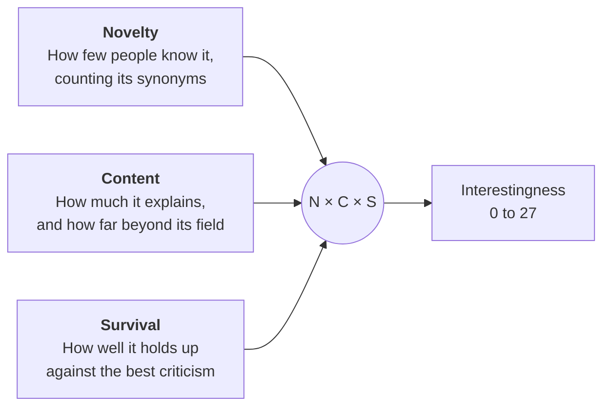
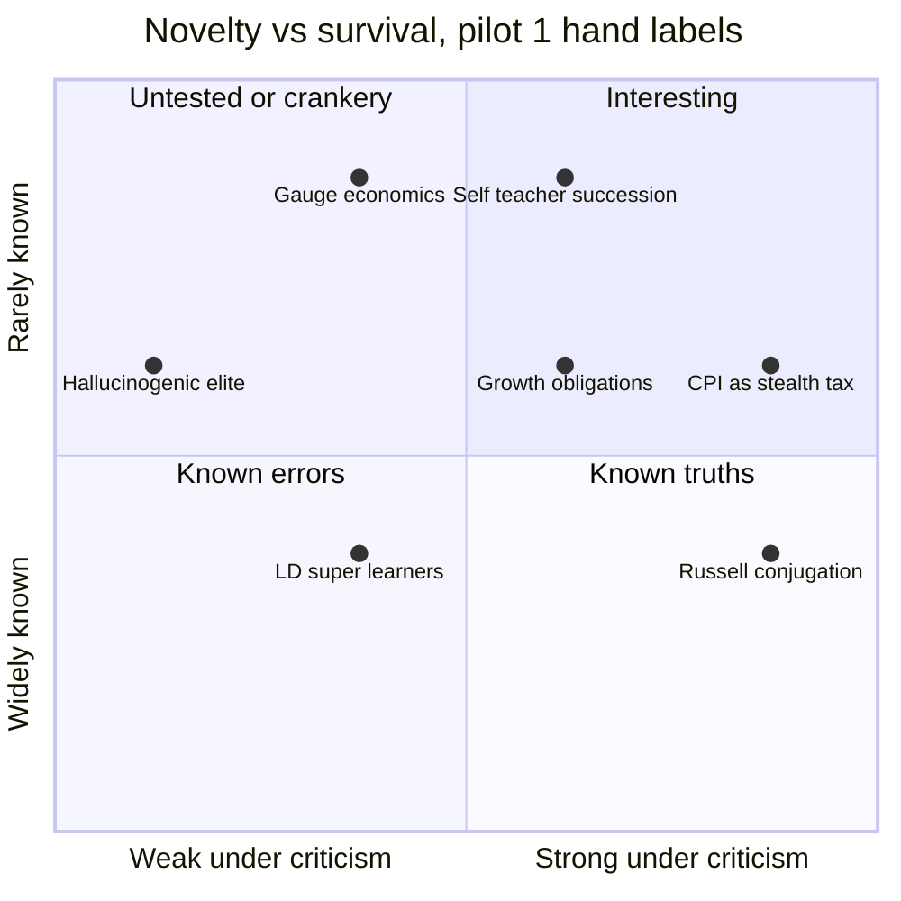
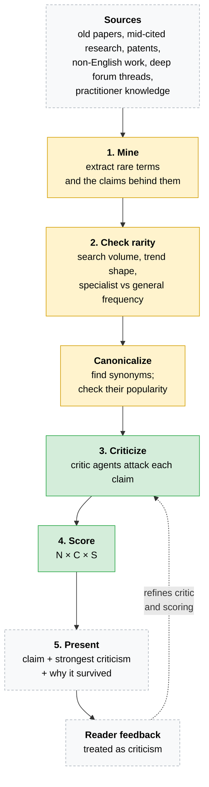
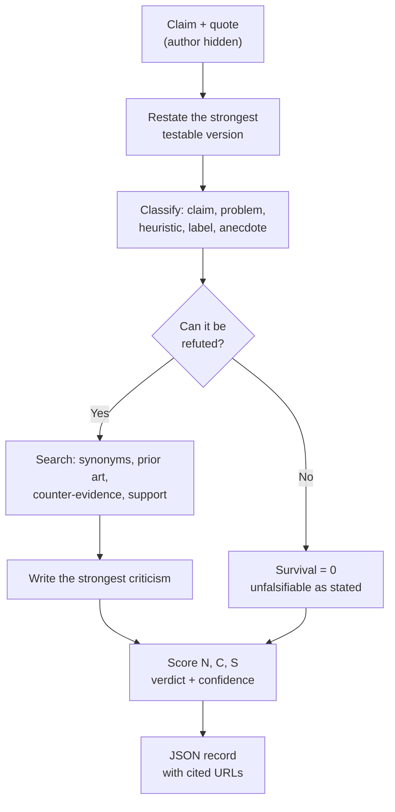
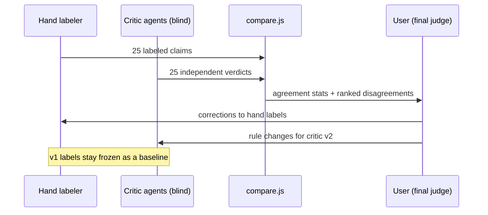

# Rare Token Miner: Overview

## Executive summary

**What we're building.** A machine that finds ideas that are true but not widely known, and problems that are real but that few people have noticed. StumbleUpon surfaced pages that were good but obscure. This aims to do the same for ideas, with a filter for truth.

**How it works.** It runs in five steps:

1. **Mine** obscure sources for rare terms and the claims behind them.
2. **Check rarity.** Look up the term's synonyms. A rare name for a popular idea doesn't count.
3. **Criticize.** An AI critic restates each claim in its strongest testable form, says what would refute it, and searches for prior art and counter-evidence.
4. **Score** each idea on three axes: novelty, content, and survival under criticism.
5. **Present** the survivors alongside their strongest criticism.

**Why this approach.** It follows Popper and Deutsch. We can't prove an idea true. We can only attack it and see whether it survives. Obscure ideas are mostly obscure because they are wrong, so most of the machine is an error filter. Finding novelty is the easy part.

**Where we are.** Pilot 1 is done: 25 ideas from a 2018 thread on Eric Weinstein, labeled by hand. Critic v1 is built and has been tested blind against those labels. It overturned several of them with evidence. Mining and rarity checks are still manual.

---

## 1. What counts as interesting

An idea is interesting when it scores well on all three axes. Each axis runs 0 to 3, and the three are multiplied, so a zero on any axis zeroes the score.

| Score | Novelty | Content | Survival |
|---|---|---|---|
| 0 | Everyone knows it | Says nothing testable | Refuted, or can't be tested |
| 1 | Known under another name | An anecdote | Contested or untested |
| 2 | Known mainly to specialists | Explains one field | Survives with caveats |
| 3 | Almost nobody says it | Explains across fields | Survives the best criticism found |

Novelty and survival together sort ideas into four groups. The chart plots a few pilot items using the hand labels, before critic review.

The top-left quadrant is the danger zone. Rare but untested ideas look exciting, and most are wrong. The critic's job is to push each of them right or down.

## 2. The pipeline

Green: built. Yellow: done by hand so far. Grey: planned.

**Canonicalization is the core step.** In pilot 1, seven of the eight top-scoring ideas already existed in specialist literature under other names. "Russell conjugation" gets 260 searches a month. "Framing effect," the same idea, gets 6,600. Novelty has to be measured on the idea, not the label.

Rebranded ideas still have value. Linking a vivid coinage to the evidence behind it is Swanson's "undiscovered public knowledge" in reverse: the popularizer has the audience, and the specialists have the tests.

## 3. The critic

Each claim goes through the same eight steps (`critic/prompt.md`). The output is one JSON record per claim (`critic/schema.json`).

The rules:
- Popularity and authority are not evidence. Only arguments count.
- Being contrarian earns a claim no credit.
- Cite only sources actually found, never from memory.
- A plausible claim nobody has tested scores survival 1, not 3.

## 4. Testing the machine

Before the critic sees new material, we test it on claims we have already labeled. The critic works blind. Where it disagrees with the hand labels, either side can be wrong, and the user settles it.

**Critic v1 results** (`runs/2026-10-30-v1/REPORT.md`):

| Measure | Result |
|---|---|
| Score rank correlation with hand labels | 0.54 |
| Same verdict | 7 of 25 |
| Critic bias vs hand | Harsher on novelty (−0.6) and survival (−0.4) |
| Citations | 125, about 5 per claim |

The critic overturned five hand labels with evidence. The clearest case: the hand label cited Autor, Levy & Murnane (2003) in support of a claim. The paper actually argues against it.

**Known weaknesses of critic v1:**
1. **Score compression.** It rarely gives a 3, so scores bunch between 2 and 6.
2. **Weak sources.** About a third of its citations are blogs, forums, or press coverage.
3. **Author leaks.** Searches surface the source's own pages, which breaks the blinding.
4. **Unchecked citations.** URLs come from search snippets and haven't been fetched to confirm them.
5. **Shared blind spots.** The critic and the hand labeler are the same model family, so agreement between them proves less than it seems.

## 5. Roadmap

| Step | Status |
|---|---|
| Concept and scoring rubric | Done |
| Pilot 1: 25 hand-labeled claims | Done |
| Critic v1 + blind comparison | Done |
| Adjudicate v1 disagreements | Next, needs the user |
| Critic v2: scale anchors, source-quality rule, citation fetch check, scoring reframings | Next |
| Critic from a different model family | Planned |
| Automated mining from long-tail sources | Planned |
| Automated rarity and synonym checks | Planned |
| Historical test: run on a 2008 web snapshot and check whether it finds ideas accepted later | Planned |
| Reader-facing "stumble" interface | Planned |

**The historical test is the real proof.** If the machine, run on an old snapshot, can't separate ideas that later proved true from ideas that stayed obscure because they were wrong, the design is refuted.

## 6. Repo map

| Path | What it is |
|---|---|
| `README.md` | Short intro and pilot 1 findings |
| `docs/OVERVIEW.md` | This document |
| `data/weinstein-2018.json` | Pilot 1: 25 hand-labeled claims |
| `score.js` | Ranks a dataset by N × C × S |
| `critic/prompt.md` | Critic instructions (v1) |
| `critic/schema.json` | Critic output format |
| `compare.js` | Compares a critic run with hand labels |
| `runs/2026-10-30-v1/` | First blind critic run + report |
